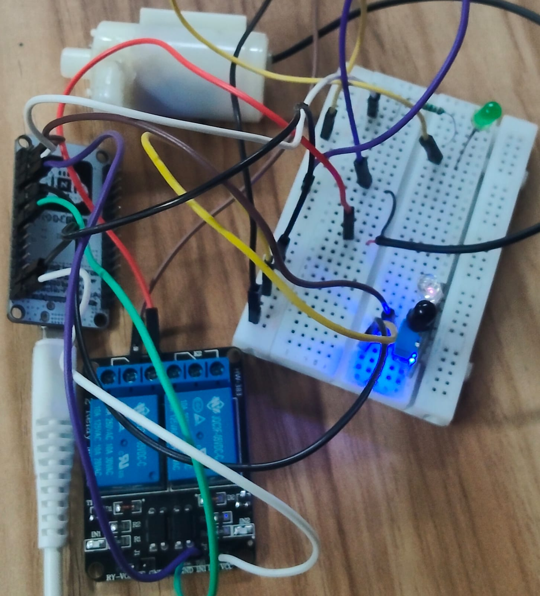
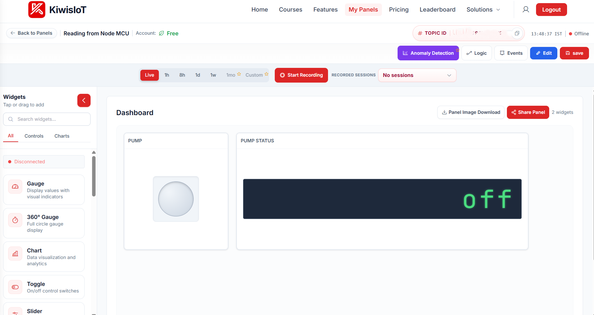

# Smart-Automatic-Dispenser-Monitoring-using-KiwisIoT-Dashboard
# Project Overview
The IoT Smart automatic Dispenser Monitoring System  is an automated dispensing system using IR sensor,NodeMCU,Relay module ,Water Pump and LED.When an object or hand is detected,the water pump automatically turns ON for few seconds.The LED indicates the dispensing status,and the activation status sent to the KiwisIoT Platform for Real-Time Monitoring.
# Components Required
- ESP8266 NodeMCU
- 2-Channel Relay Module
- 5V DC Water Pump
- Jumper Wires
- Power Supply
- Wi-Fi Connection
- IRSensor
- LED
# Working Principle
1.The IR sensor continuously detects nearby objects.

2.When a hand is detected, the IR sensor sends a LOW signal to the NodeMCU.

3.The NodeMCU activates the relay module.

4.The water pump turns ON for 2 seconds.

5.The LED turns ON during the dispensing operation.

6.After 2 seconds, the pump and LED turn OFF.

7.The dispenser status is updated on the KiwisIoT dashboard.

8.The system waits until the detected object is removed before detecting another object.
# Software Requirements
- Arduino IDE
- ESP8266 Board Package
- ESP8266WiFi Library
- KiwisIoT Library
# Project Images

# Source Code
[View Code](dispenser.ino)
# Platform
*IoT Platform:*[KiwisIoT](https://kiwisiot.in)
